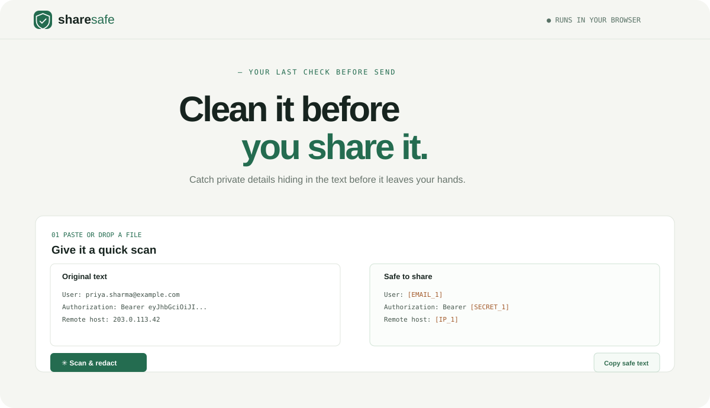

# ShareSafe

**Clean it before you share it.** ShareSafe helps remove secrets and personal details from logs, support tickets, and messages before you paste them into a public issue or AI chat.

**[Open the live app](https://westwordcorp.com/tools/sharesafe/)** · **[Report a bug](https://github.com/harshgulatidev/sharesafe/issues)**

## Why it exists

An error log can quietly contain an email, a bearer token, or a customer IP address. ShareSafe gives you a quick review step before the text leaves your device. It scans in your browser, replaces detected values with consistent placeholders, and lets you add private terms of your own.

## What it can scan

- Common credential shapes: bearer tokens, JWTs, GitHub, AWS, Slack and Stripe keys, private key blocks, and secret values assigned to common names such as `password` or `api_key`.
- Email addresses, phone numbers, and IPv4 addresses.
- Your own exact words and phrases, matched without case sensitivity.
- Plain text pasted into the editor or loaded from `.txt`, `.log`, and `.json` files.

Repeated values use the same placeholder during a scan, so the cleaned log stays readable. For example, the same email becomes `[EMAIL_1]` everywhere.

## Privacy

ShareSafe has no backend. Scanning and file reading happen in the browser; source text is not sent to a service or saved by the app. Clearing the page clears its in-memory text. The page loads its fonts from Google Fonts; self-host the fonts or remove the `@import` in `style.css` if you want every request to stay on your device.

## Use it

Open the live app, paste a log, choose what to scan, and select **Scan & redact**. Review the result carefully before copying it. You can also drop a `.txt`, `.log`, or `.json` file onto the source panel. `Ctrl + Enter` scans the text.

Or run it locally by opening `index.html`, or serve this folder with any static web server.

## Limits

Pattern matching is a helpful last check, not a guarantee. It may miss an unfamiliar secret or flag a harmless value. Review the output and remove anything private that remains. ShareSafe does not replace GitHub secret scanning or push protection.

## Contributing

Bug reports and focused detection improvements are welcome. Add test cases with fake values only; never put real credentials or personal data in an issue or pull request.

## License

MIT. See [LICENSE](LICENSE).
